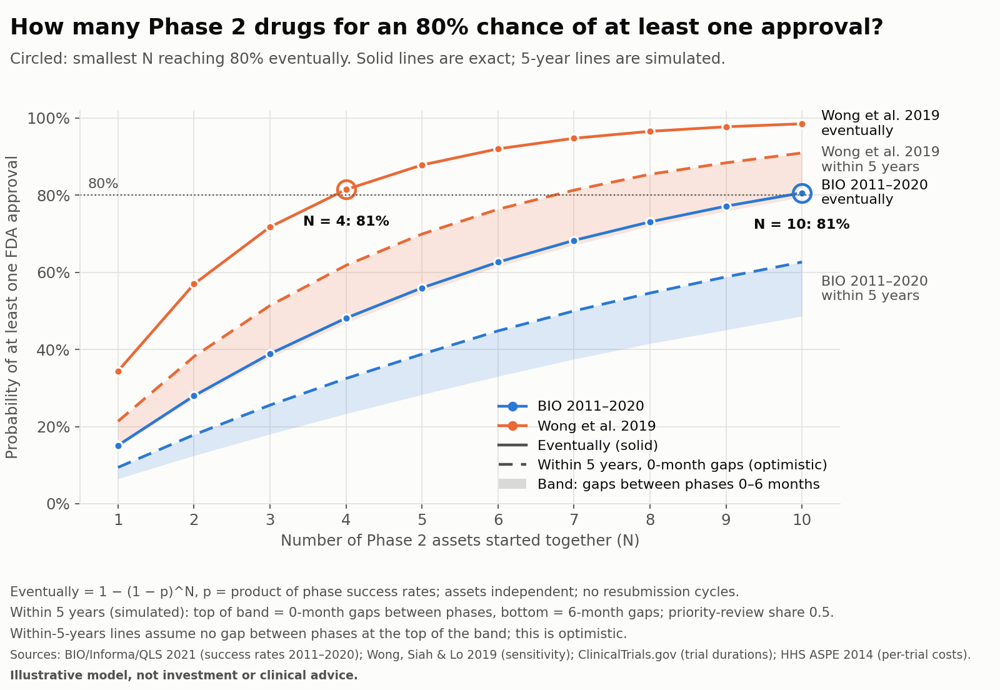

# biotech-pipeline-mc



## Summary

How many Phase 2 drugs does a company need for an 80% chance of at least one FDA approval? This Monte Carlo
model answers it from public data only: ClinicalTrials.gov trial durations, FDA review goals, published
phase success rates (BIO 2011–2020; Wong et al. 2019) and HHS ASPE per-trial cost estimates.

- **The success-rate source matters most for the odds of approval.** One Phase 2 asset is eventually
  approved with probability 15.1% (BIO) or 34.4% (Wong); reaching 80% takes 10 assets with BIO rates
  and 4 with Wong rates.
- **More assets reduce the risk of getting nothing, not the cost per approval.** With 5 assets, P(zero
  approvals) is 44.0% (BIO) or 12.2% (Wong). Expected trial cost per approved drug is about $126M (BIO)
  or $73M (Wong) at any portfolio size.
- **Time changes the picture.** Within 5 years, 10 assets under BIO rates give at best 62.7% (no gaps
  between phases) and 48.7% with 6-month gaps.

Probabilities and costs above are closed-form values; the simulation is checked against them in the test
suite. The within-5-years figures depend on trial durations, have no closed form, and are simulated
(200,000 portfolios). Assets are treated as independent, and costs cover direct Phase 2/3 trial costs
only (one trial per phase, 2004–2012 nominal US$), so they are not comparable with total R&D cost
estimates that include failures and capital costs. Illustrative model, not investment or clinical advice.

Figures: [docs/figures/](docs/figures/). License: [MIT](LICENSE) for the code.

> Status: data inventory complete; the model (gates + timing + clinical trial direct cost and risk report)
> is implemented and tested; figures are generated.

## Research question

For a biotech company holding N Phase 2 drugs, what is the probability that at least one is approved?
How much will it spend on clinical trials, and how long will it take? Do the conclusions agree under two
public sources of success rates (BIO 2011–2020 and Wong et al. 2019)?

## Scope

- The starting point is a Phase 2 drug. In the BIO scenario the gates are Phase 2 → Phase 3 →
  submission → approval; in the Wong scenario, Phase 2 → Phase 3 → approval (two gates).
- Each gate is one random draw; a failure ends the asset.
- Phase durations are resampled from completed industry trials on ClinicalTrials.gov.
- Phase costs use the HHS ASPE report's average cost per trial (fixed values, not sampled), in 2004–2012
  nominal US dollars; spending varies with how far each drug gets. Low/high-cost therapeutic areas and
  three cost multipliers are sensitivity analyses.

## Limitations

- Drugs are assumed independent. Drugs sharing a platform technology may fail together, so the model
  understates risk.
- Success rates come from academic and industry sources, not government data.
- Durations come from completed trials only. The absence of long trials that have not yet finished may
  bias durations short (most visibly for trials started in 2020 or later). Including terminated trials
  raises the medians by about 0.7–0.8 months (Phase 2 17.2 → 17.9, Phase 3 20.1 → 20.9); this is kept as a
  sensitivity analysis.
- This is a learning project, not investment or clinical advice.

## Data sources

| Source | Content | Local file | Retrieved |
|---|---|---|---|
| ClinicalTrials.gov API v2 (`/api/v2/studies`) | Phase 2/3 trials: phase, status, start date, primary completion date, study type, lead sponsor class | `data/raw/ctgov_phase2_3_20261028T000018Z.jsonl.gz` + `.manifest.json` | 2026-10-28 00:00 UTC (API data timestamp 2026-10-27T09:00:04) |
| BIO / Informa / QLS, *Clinical Development Success Rates and Contributing Factors 2011–2020* (Feb 2021) | Phase transition success rates (Fig. 2, p.7), likelihood of approval (Fig. 5b, p.11) | `data/sources/bio_2011_2020.pdf` | 2026-10-27 |
| Wong, Siah & Lo (2019), *Biostatistics* 20(2):273–286, doi:10.1093/biostatistics/kxx069 | Probability of success by phase and therapeutic group (Table 2) | `data/sources/wong2019_epmc.xml` (Europe PMC full-text XML) | 2026-10-27 |
| FDA, PDUFA VII commitment letter; FDA *New Drug Therapy Approvals 2023*; HHS ASPE (Sertkaya et al. 2014) | Review-time goals; priority-review reference; cost per trial | `data/sources/` (see below) | 2026-10-28 |

**Copyright: data and publications belong to their respective sources** (ClinicalTrials.gov; BIO / Informa /
QLS; Wong et al. and Oxford University Press; FDA; HHS ASPE). This repository contains only code, the
assumptions table (`data/assumptions.csv`) and derived summary results (`data/processed/`, `docs/`); the
code is licensed under [MIT](LICENSE). The documents under `data/sources/` are **not in the repository**.
For each document's full title, authors, year, download link and the `assumptions.csv` rows it supports,
see [data/sources/README.md](data/sources/README.md).

`data/raw/` is gitignored. Snapshots can be re-fetched with `scripts/fetch_ctgov.py`, but ClinicalTrials.gov
is updated continuously, so every manifest records the API data timestamp.

### ClinicalTrials.gov snapshot

- Query: `filter.advanced=AREA[Phase](PHASE2 OR PHASE3)`, **133,219** records (complete, 134 pages).
- By phase: PHASE2 65,948; PHASE3 42,470; PHASE1+PHASE2 17,165; PHASE2+PHASE3 7,636.
- Lead sponsor class: INDUSTRY 54,345; OTHER 68,574; remaining classes 10,300.

### Trial durations (months)

Produced by `scripts/clean_durations.py`. Filter steps, remaining counts and outlier handling are in
[docs/filter_log.md](docs/filter_log.md).

Common filters: industry lead sponsor, interventional, completed, single-phase trials. There are four
date rules; **rule d is the main scenario** (DECIDED), the others are sensitivity analyses:

| Rule | Definition |
|---|---|
| a | Dates without a type label are treated as actual (ESTIMATED dates still excluded) |
| b | Start and primary completion dates both labelled ACTUAL (strict) |
| c | Rule a, start year 2011–2020 |
| d | Rule a, start year 2010–2019 |

| Rule | Phase | n | Median | P25 | P75 |
|---|---|---|---|---|---|
| a | Phase 2 | 13,616 | 17.0 | 9.9 | 28.4 |
| a | Phase 3 | 14,892 | 19.8 | 11.6 | 32.0 |
| b | Phase 2 | 6,743 | 18.5 | 10.9 | 30.6 |
| b | Phase 3 | 7,074 | 21.6 | 12.6 | 35.3 |
| c | Phase 2 | 6,286 | 17.6 | 10.0 | 29.5 |
| c | Phase 3 | 6,777 | 20.7 | 12.0 | 33.9 |
| d | Phase 2 | 6,479 | 17.2 | 10.0 | 29.0 |
| d | Phase 3 | 7,051 | 20.1 | 12.0 | 33.7 |

Outliers: trials with duration ≤ 0, < 1 month, or > 180 months (15 years) are excluded (not winsorized);
excluded rows are saved in `data/processed/durations_excluded.csv`. The < 1 month rule moves the medians
by 0.03–0.30 months. Combined-phase trials (sensitivity), the terminated-trials sensitivity, results by
start-year band and the counts at each step are in filter_log.md.

Resampling vectors (columns `phase, duration_months, nct_id, start_year`, completed trials only):
`data/processed/durations_main.csv` is rule d (main scenario); `durations_rule_a.csv` (all years),
`durations_rule_b.csv` and `durations_rule_c.csv` are for sensitivity analyses.

### Success rates (full data in `data/assumptions.csv`)

| Transition | BIO 2011–2020 (p.7) | Wong 2019 Table 2, all indications |
|---|---|---|
| Phase 1 → 2 | 52.0% (n=4,414) | 66.4% |
| Phase 2 → 3 | 28.9% (n=4,933) | 58.3% |
| Phase 3 → NDA/BLA | 57.8% (n=1,928) | — |
| NDA/BLA → approval | 90.6% (n=1,453) | — |
| Phase 3 → approval | 52.4% (LOA, p.11) | 59.0% |
| Phase 1 → approval | 7.9% (LOA, p.11) | 13.8% |

### The `status` column of `data/assumptions.csv`

| Value | Meaning |
|---|---|
| `SOURCED` | Value taken directly from a source document (success rates parsed by code; ASPE costs transcribed with page numbers). Cost rows also have a `role` column: `base` = base case, `sensitivity` = sensitivity analysis only |
| `DECIDED` | No official data, but a project decision has been made; the reason is in the `rationale` column |
| `ASSUMPTION` | No official data and not yet decided; value left empty (exception: `gap_months` and `review_extra_months` record the default 0 set for the project) |
| `DO_NOT_USE` | The source value is doubtful and must not be used until checked against the journal PDF |
| `CANDIDATE` | A candidate value with a verified source, not adopted; the model does not read it |

`page_verified=no` means the page number has not been checked against the journal PDF (see limitations).

## Assumptions

**Decided (DECIDED)**; reasons in the `rationale` column of `assumptions.csv`:

- Success rates: BIO 2011–2020 is the main scenario, Wong 2019 the sensitivity scenario; never mixed in
  one simulation.
- The main duration sample uses rule d (completed, untyped dates treated as actual, start year
  2010–2019). Reasons: its medians lie between rules a and b; no era trend across 2005–2019; excluding
  2020 and later avoids right-censoring. Rules a/b/c and "completed + terminated" are kept as
  sensitivity analyses.
- Review time: priority review 8 months, standard review 12 months (FDA PDUFA VII, NME / original BLA,
  from submission), drawn with probability p_priority. In the Wong scenario the Phase 3 → approval gate
  takes Phase 3 duration + review time.
- A failed drug's cumulative time runs to the end of the gate where it fails.
- Phase costs: the base case is the ASPE 2014 Table 2 weighted mean (Phase 2 $13.35M, Phase 3 $19.89M per
  trial, SOURCED, `role=base`); the Table 1 therapeutic-area minimum/maximum are sensitivity only
  (`role=sensitivity`). A phase's cost is paid on entering the phase, whether it succeeds or fails:
  Phase 2 always, Phase 3 only after passing Phase 2. Total cost = trials_per_phase ×
  overhead_multiplier × cpi_factor × sum of phase costs.
- **Costs are not sampled.** ASPE does not publish trial-level variance (the Table 2 SD is the spread
  between therapeutic-area means), so there is no sourced distribution to sample from. Spending varies
  with how far each drug gets.
- Submission and review costs are not counted (see limitations).
- The Wong scenario does not split Phase 3 → approval; it uses two gates (P2_P3, P3_APP).
- Only trials with an industry lead sponsor (lead sponsor class = INDUSTRY) are kept, matching the
  industry scope of BIO and Wong.
- Dates given only as `YYYY-MM` are imputed to the 15th of the month.
- Combined Phase 1/2 and Phase 2/3 trials are not in the main sample; they are saved separately for
  sensitivity analysis.
- Trials with duration ≤ 0, < 1 month, or > 15 years are excluded.
- Phase 2/3 durations are proxied by trial duration (start → primary completion).

**Still ASSUMPTION**:

- **ASSUMPTION**: mapping between trials and drug programs; trial duration is a proxy for phase duration.
- **ASSUMPTION**: share of priority reviews, p_priority. No value; passed to the model as a parameter.
  **Sensitivity range: 0 / 0.5 / 1.** Reference (not a model input): FDA CDER *New Drug Therapy Approvals
  2023*, printed p.11: 31 of 55 novel drugs (56%) had priority review. Two biases if this number were
  used: (1) it is a share of **approved** drugs, not of submissions (rejected applications are not in
  the denominator); (2) it covers CDER only and **excludes CBER** biologics. The yearly Novel Drug
  Approvals web lists have no priority-review column.
- **ASSUMPTION**: the model has **no** complete-response and resubmission cycles; each submission has one
  review period.
- **ASSUMPTION**: `gap_months` (`ASSUMPTION_GAP_MONTHS`), time between phases, default 0. Added twice on the
  path: Phase 2 end → Phase 3 start, and Phase 3 end → submission. **Sensitivity range: 0 / 3 / 6 months.**
- **ASSUMPTION**: `review_extra_months` (`ASSUMPTION_REVIEW_EXTRA_MONTHS`), extra time on every review
  beyond the PDUFA goal, default 0; no sensitivity range set.
- **ASSUMPTION**: `trials_per_phase`, number of trials per phase, default 1; **sensitivity: 1, 2**.
- **ASSUMPTION**: `cpi_factor`, price-level adjustment, default 1.0 (no adjustment: results are in
  mixed-year 2004–2012 nominal dollars).
- **ASSUMPTION**: `overhead_multiplier`, sponsor costs beyond the ASPE trial costs, default 1.0;
  **sensitivity: 1.5, 2.0**.
- **Note on sensitivity: the three cost multipliers enter the formula only as a product** (total cost =
  trials_per_phase × overhead_multiplier × cpi_factor × sum of phase costs), so `trials_per_phase = 2`
  and `overhead_multiplier = 2` give identical results. `trials_per_phase` currently scales both
  Phase 2 and Phase 3; representing "two trials in one phase only" would need a different formula.
- **ASSUMPTION**: phase outcomes are independent, and so are the programs in the pipeline.
- **ASSUMPTION**: historical success rates apply to the future.

## Limitations (data and method details)

### Success-rate sources

- Success rates come from two industry-level historical studies, not from this project's own estimates
  on ClinicalTrials.gov. ClinicalTrials.gov registers trials and has no record of whether a program moved
  to the next phase, so transition probabilities cannot be computed from it directly.
- **BIO 2011–2020**: Biomedtracker data, phase-by-phase method (programs advancing ÷ programs advancing or
  suspended), with a separate NDA/BLA → approval phase; its period is closer to the ClinicalTrials.gov
  sample.
- **Wong 2019**: Citeline data (2000–2015), path-by-path method, no separate NDA phase, standard errors
  reported. Its Phase 2 → 3 is 58.3% versus BIO's 28.9%; the gap comes mainly from different methods and
  periods.
- **The two are never mixed within one simulation.** BIO is the main scenario and Wong the sensitivity
  scenario (ASSUMPTION_SUCCESS_RATE_SOURCE, decided).
- Both sources are industry-wide averages and do not reflect differences between companies,
  indications or drug types.
- BIO's Phase 1 success rate may be biased upward because failed programs are less often disclosed (noted
  in the report, p.6).

### Independence

- Each phase transition is an independent Bernoulli event: the probability of success in a phase depends
  only on that phase, not on how earlier phases went. In reality, programs with stronger early data may
  succeed more often later.
- Programs in the pipeline are also treated as independent. If several share a target, platform
  technology or mechanism of action, failures may be highly correlated, and the independence assumption
  **understates** the probability that all fail, making the tail of the outcome distribution too narrow.
- Duration and success are also treated as independent. In reality terminated trials have different
  durations from completed ones (longer in this data), while the duration sample includes completed trials
  only.

### Data

- **Wong 2019 page numbers are not verified.** PDF downloads from OUP and PMC were blocked (403 / bot
  check), so values come from the Europe PMC XML; pages give only the article range 273–286 and are marked
  `page_verified=no`.
- **Wong Table 2 "All without oncology" rows are `DO_NOT_USE`.** In both the all-indications and
  lead-indications blocks, that row's POS(2→3) equals POS(2→APP) (27.3/27.3, 29.0/29.0), likely a
  typesetting error. The "Overall" row's SE is inconsistent with its n; this is flagged in `notes`.
- **The strict rule (b) sample is skewed toward recent years.** Older ClinicalTrials.gov records often lack
  a date-type label and rule b drops them: it keeps 12% of completed trials from the 2000s versus 85% under
  rule a (see filter_log.md).
- **Under rule a more than half of trials have at least one month-only date** (6% under rule b); imputing
  the 15th adds about ±0.5 months of error.
- **Trial duration is not phase duration.** A phase may contain several parallel or sequential trials,
  with gaps between them.
- Only completed trials are included: long trials not yet finished are missing, which biases durations
  short, especially for recent start years. Terminated trials, by contrast, have **longer** median
  durations from start to primary completion (the stop date) than completed trials, by 0.8–4.8 months (see
  the TERMINATED sensitivity in filter_log.md); including them raises the overall medians by only
  0.0–0.8 months. So in this data, excluding terminated trials does not bias durations long.
- Failed drugs in the model also use completed-trial durations. If failure-path durations are biased,
  the bias is toward shorter: terminated trials (the proxy for failure) last longer than completed ones.
- **The base case has 0 months between phases, which biases timelines short.** In practice there are
  usually gaps between Phase 2 end and Phase 3 start and between Phase 3 end and submission; the
  `gap_months` sensitivity (0 / 3 / 6) is in docs/timed_results.md.
- **The model has no resubmission cycles.** Yet BIO's submission → approval rate of 90.6% includes
  approvals after resubmission: those drugs get only one review period in the model, so their time to
  approval is understated.

### Clinical trial direct cost

- **ASPE costs are the cost of one trial**, not of a whole program, and include no allocation of failed
  programs' costs (printed p.3-2). Failure is handled by the gate simulation: a failed drug still pays for
  every phase it entered.
- **Submission and review costs are not counted.** ASPE's submission column is only the PDUFA filing fee
  (`ASPE14_COST_NDA_FEE`, CANDIDATE, reference only); there is no source for the sponsor's cost of
  preparing a submission.
- **Currency is nominal US dollars of mixed years** (2004–2012 contract data, not inflation-adjusted);
  `cpi_factor` defaults to 1.0, so results are not converted to any single year's dollars. Undiscounted.
- **Costs are budgeted, not realized**: negotiated contract rates × planned enrollment and number of
  sites; the report does not say whether early-stopped trials are in the sample.
- **U.S. trials only.**
- VaR and CVaR carry limited information in this model: costs are fixed, so the total cost of N drugs
  takes only N+1 possible values, with an upper bound of N × (Phase 2 + Phase 3 cost); for small N, VaR
  equals CVaR. The main risk measures are P(zero approvals) and the cost when there are zero approvals.
- The model counts only the direct cost of one Phase 2 and one Phase 3 trial per drug, excluding Phase 1,
  preclinical work, cost of capital and present value, in 2004–2012 nominal dollars. It cannot be compared
  directly with total R&D cost estimates in the literature that include failures and capital costs.
- The ASPE Table 2 SD measures differences between therapeutic areas and cannot be read as the
  uncertainty of a single trial's cost; in the Table 1 min/max sensitivity, the Phase 2 and Phase 3
  extremes come from different therapeutic areas.
- The footnote text for BIO p.11 "Gastroenterology\*" cannot be found in the PDF text layer.
- **Multiplying Wong's two gates does not match the published figure.** 0.583 × 0.590 = 34.4%, while Wong
  Table 2 prints Phase 2 → approval as 35.1% (under the path-by-path method, the product of the phase POS
  need not equal the overall POS). The model keeps the published numbers and multiplies the two gates as
  scoped, giving 34.4%, not adjusted to 35.1%. BIO's three gates multiply to 15.13%, consistent with its
  LOA of 15.1%.

## Model

`src/biotech_pipeline_mc/`:

**Gates**

- `params.py`: `load_gate_probs(scenario)` reads success rates from `data/assumptions.csv` by `param_id`,
  accepting only `status=SOURCED` rows.
  - BIO: `BIO21_POS_P2_P3_ALL_INDICATIONS`, `BIO21_POS_P3_NDA_ALL_INDICATIONS`, `BIO21_POS_NDA_APP_ALL_INDICATIONS`
  - Wong: `WONG19_ALL_P2_P3_OVERALL`, `WONG19_ALL_P3_APP_OVERALL`
- `gates.py`: `simulate_asset(gate_probs, n, rng)` draws one Bernoulli per gate, stopping at the first
  failure, and returns `stopped_at` (index of the failed gate, or the number of gates if approved) and
  `approved`. Fixed seed `DEFAULT_SEED`, `numpy.random.Generator`.

Simulated vs analytic values: [docs/gate_validation.md](docs/gate_validation.md).

**Timing**

- `params.py`: `load_duration_vectors()` reads `durations_main.csv`; `load_review_months()` reads
  `FDA_PDUFA_PRIORITY_NME` and `FDA_PDUFA_STANDARD_NME` by `param_id` (SOURCED/DECIDED only).
- `timing.py`: one Phase 2 and one Phase 3 duration are resampled from the vectors; review time is drawn
  as 8 or 12 months with `p_priority` (a required parameter with no default). Gate durations: BIO is
  Phase 2 / gap + Phase 3 / gap + review + extra review time; Wong is Phase 2 / gap + Phase 3 + gap +
  review + extra review time (`gap_months` and `review_extra_months` default to 0).
  `simulate_asset_timed` returns where each drug stopped, whether it was approved, and its cumulative
  time (to the end of the stopping gate); `simulate_portfolio_timed` simulates N drugs starting together
  and returns the number approved and the time of the first approval.
- Results (BIO and Wong side by side; p_priority = 0 / 0.5 / 1 × gap_months = 0 / 3 / 6; P(at least one
  approved within 5 / 7 / 10 years), P(zero approvals), time to first approval):
  [docs/timed_results.md](docs/timed_results.md).

**Clinical trial direct cost and risk**

- `params.py`: `load_value(param_id, column, allowed_status)` and `load_sensitivity_values(param_id)`; all
  values and sensitivity ranges are read from `assumptions.csv` by name.
- `costs.py`: `analytic_cost_distribution` gives the exact discrete distribution of the total cost of N
  drugs (with the joint probability of zero approvals), from which `discrete_quantile` and
  `discrete_var_cvar` compute quantiles and VaR/CVaR. `load_cost_inputs(cost_case, **overrides)` reads
  phase costs (SOURCED only) and the three multipliers; `gate_costs` gives the cost paid on entering each
  gate (BIO: Phase 2 / Phase 3 / 0; Wong: Phase 2 / Phase 3); `asset_costs` sums cost up to each drug's
  stopping gate; `analytic_expected_asset_cost` = Phase 2 cost + P(pass Phase 2) × Phase 3 cost;
  `var_cvar` computes VaR95 and CVaR95 (high cost is the bad tail). The module contains no numeric inputs
  (checked by a test).
- `timing.py`: `simulate_portfolio_assets` returns per-drug results (shape n × N), so timing and cost come
  from the same simulation.
- Results (N = 1–10, BIO and Wong side by side: cost distribution, VaR95/CVaR95, zero approvals, expected
  cost per approved drug, probability of approval within 5/7/10 years, sensitivity):
  [docs/cost_results.md](docs/cost_results.md).

**Figures**

`scripts/make_figures.py` reads only `data/processed/*.csv` and `assumptions.csv` (no new simulation) and
writes to `docs/figures/` (1600 px wide; BIO is always blue #2a78d6 and Wong orange #eb6834, a pair checked
for color-vision deficiency). The numbers behind each figure are in
[docs/figures/figure_numbers.md](docs/figures/figure_numbers.md).

- **Number rule: probabilities and costs quoted in this README and on the figures are analytic values**
  (closed-form or exact discrete distributions); simulated values are used only for verification. The
  exception is approval within X years, which depends on durations, has no closed form, and is simulated.
  Examples: single-drug approval probability 15.1% (BIO) and 34.4% (Wong); expected trial cost per
  approved drug $126M (BIO) and $73M (Wong), independent of N. Analytic and simulated values side by side
  are in figure_numbers.md and section 5 of cost_results.md.
- Fig 1 `fig1_p_approval_by_n.png`: P(at least one approval) vs N = 1–10. Solid lines: eventually
  (analytic, 1 − (1 − p)^N). Dashed lines: within 5 years (simulated, p_priority = 0.5); the dashed line is
  the top of a band = 0-month gaps between phases (optimistic), the bottom of the band = 6-month gaps.
  Marks the N needed to reach 80% eventually (BIO 10, Wong 4).
- Fig 2 `fig2_cost_distribution_n5.png`: distribution of clinical trial direct cost for N = 5 (exact
  binomial probabilities, discrete bars); hatching marks the share with zero approvals.
- Fig 3 `fig3_sensitivity.png`: tornado charts for (i) P(at least one approval within 5 years), N = 5
  (simulated), and (ii) expected cost per approved drug (analytic); only factors that change the metric
  are shown. The 10-year results are listed in figure_numbers.md only.

## How to reproduce

Requires Python 3.9 or later (developed on Python 3.9.6, macOS).

**1. Set up the environment**

```bash
python3 -m venv .venv
.venv/bin/pip install --upgrade pip   # pip 21 bundled with Python 3.9 cannot do editable installs from pyproject
.venv/bin/pip install -r requirements.lock
.venv/bin/pip install -e ".[test,figures]" --no-deps
```

`requirements.lock` was produced with `pip freeze --exclude-editable` (pinned numpy, pypdf, pytest,
matplotlib and their dependencies).

**2. Run the tests**

```bash
.venv/bin/python -m pytest
```

The tests need only files in the repository (`data/assumptions.csv`, `data/processed/durations_main.csv`);
nothing has to be downloaded.

**3. Rerun the model and figures** (using the assumptions and durations in the repository, in this order)

```bash
.venv/bin/python scripts/validate_gates.py      # gates: simulated vs analytic -> docs/gate_validation.md
.venv/bin/python scripts/run_timed.py --p-priority 0 0.5 1 --gap-months 0 3 6   # time to first approval -> docs/timed_results.md
.venv/bin/python scripts/run_costs.py           # clinical trial direct cost and risk -> docs/cost_results.md
.venv/bin/python scripts/make_figures.py        # figures -> docs/figures/ (reads the run_costs.py outputs)
```

Seeds are fixed, so the results match the files in the repository (apart from run timestamps).

**4. (Optional) Rebuild the inputs from raw data**

```bash
.venv/bin/python scripts/fetch_ctgov.py         # fetch a ClinicalTrials.gov snapshot -> data/raw/ (never overwrites)
.venv/bin/python scripts/clean_durations.py     # newest complete snapshot -> data/processed/durations_*.csv, docs/filter_log.md
# download the source documents into data/sources/ first (see data/sources/README.md)
.venv/bin/python scripts/build_assumptions.py   # rebuild data/assumptions.csv from the source documents
```

Then run step 3 again. ClinicalTrials.gov is updated continuously, so a new snapshot will not reproduce the
committed durations exactly; each snapshot's manifest records the API data timestamp.

## Directory layout

```
LICENSE            MIT (code)
data/raw/          ClinicalTrials.gov snapshots + manifests (gitignored)
data/sources/      README.md (document list and download links); the documents themselves are gitignored
data/processed/    duration vectors (durations_main.csv = rule d, durations_rule_a/b/c.csv), full list with rule
                   flags, excluded rows, per-rule summaries, terminated-trials sensitivity, < 1 month exclusion
                   comparison, start-year bands, gate_validation.csv, timed_first_approval.csv,
                   cost_results.csv, cost_approval_within.csv, cost_distribution.csv
data/assumptions.csv
docs/filter_log.md      filter steps and counts (from clean_durations.py)
docs/gate_validation.md simulated vs analytic gates (from validate_gates.py)
docs/timed_results.md   time to first approval (from run_timed.py)
docs/cost_results.md    clinical trial direct cost and risk report (from run_costs.py)
docs/figures/           three PNGs and figure_numbers.md (from make_figures.py)
scripts/           fetch_ctgov.py, build_assumptions.py, clean_durations.py, validate_gates.py, run_timed.py, run_costs.py, make_figures.py
src/biotech_pipeline_mc/   params.py, gates.py, timing.py, costs.py
tests/             test_gates.py, test_timing.py, test_costs.py
```
